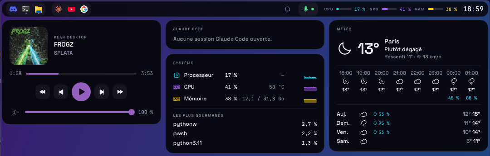
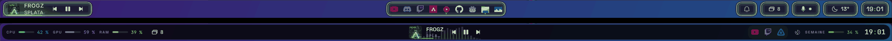
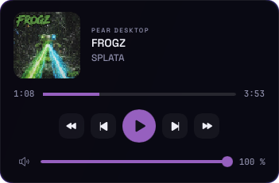
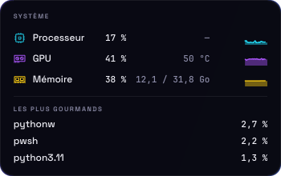
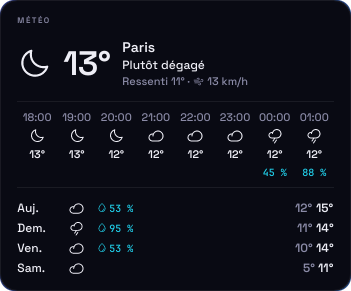
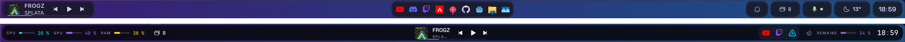

# Horizon

**A fast, modular toolbar at the top of every screen, for Windows 10 and 11.**

Music, shortcuts, notifications, system stats, Claude Code sessions, weather, calendar…
in one native app that uses ~50 MB of memory and stays out of your way.

[**Download**](https://github.com/KingsRequin/horizon/releases/latest) ·
[Features](#features) ·
[Install](#install) ·
[FAQ](#faq) ·
[Français](README.md)

> [!NOTE]
> The interface is in **French** for now. Translations are welcome: see [CONTRIBUTING.md](CONTRIBUTING.md).

## Why Horizon?

- **Native and light.** Rust + Slint, software rendering, one process: ~50 MB of memory and
  ~1.5 % of one CPU core at rest for four bars. No Electron, no WebView.
- **Every screen gets its own bar.** It reserves its space, so maximized windows start below
  it, and hides when a window goes fullscreen.
- **Yours to arrange.** Drag widgets around, pick a style per screen, make a bar taller to show
  panels as tiles, switch layouts automatically per app.
- **Updates itself.** New versions come from GitHub Releases, checked with SHA-256 and
  installed at the next start.

## Features

**It follows the music.** While something plays, the islands light up with the bass and flash on
every kick, in the colors of the album art (the graphic style shows a spectrum). Updated at most
20 times per second, and only when something changes.

<table>
<tr>
<td width="33%" valign="top"></td>
<td width="33%" valign="top"></td>
<td width="33%" valign="top"></td>
</tr>
<tr>
<td valign="top"><b>Now playing</b> — cover, controls, seek with the wheel, per-app volume. The
bar glows with the bass, in the colors of the album art.</td>
<td valign="top"><b>System</b> — CPU, GPU and memory as graphs or gauges, and the apps that use
them the most.</td>
<td valign="top"><b>Weather</b> — now, hour by hour and the next days (Open-Meteo, no account
needed).</td>
</tr>
</table>

Hover a widget to see its panel; make a bar taller and panels become **tiles** (picture above),
or keep them in a **drawer** that drops over your windows without taking screen space (handy on
a vertical screen).
Every feature in detail (French): [docs/guide.md](docs/guide.md).

**Two styles, one per screen** — "islands" (top) or "graphic" (bottom):

**Edit mode** — right-click a bar → *Modifier la barre*: drag widgets between zones and screens,
<kbd>+</kbd> to add one, <kbd>Ctrl</kbd>+<kbd>Z</kbd> to undo.

**Command palette** (<kbd>Ctrl</kbd>+<kbd>Alt</kbd>+<kbd>P</kbd>) — fuzzy search over your
shortcuts, Start menu apps, audio devices, timer, profiles and more.

**Widgets**

| | |
|---|---|
| 🎵 **Now playing** | Any app that talks to Windows media controls (Spotify, browsers, YouTube Music…) |
| 🚀 **Shortcuts** | Any icon (brand logos, images, app icons), a dot when the app is open, click to focus or launch |
| 🔔 **Notifications** | Windows notifications with a dynamic island, Do not disturb, mute per app |
| 📊 **System** | CPU, GPU, memory as graphs or gauges |
| 🎙️ **Microphone & audio** | Default devices, favorites, per-app volume |
| 🤖 **Claude Code** | Sessions (working, waiting, permission requests), token usage, bring the terminal back; subscription quota |
| 🎧 **Headset battery** | 30+ wireless headsets read directly over HID (Logitech, SteelSeries, HyperX, Razer, Corsair, Astro, Audeze, JBL) |
| 🌤️ **Weather**, 📅 **Calendar** | Open-Meteo; any iCal address (Google, Outlook…) |
| 🖥️ **Servers** | Hosts from `~/.ssh/config`, online status and latency, SSH in one click |
| 🪟 **Windows** | Open windows per screen; bring one to the current screen (click) or send it to another one (right-click) |
| ✨ **Suggestions** | Apps and sites you use at this time of day |
| 🌀 **[Essaim](https://github.com/KingsRequin/essaim)** | Pause and tune the music-reactive cursor |

**And also:** timer and pomodoro, volume and media on-screen display in place of Windows',
accent color from the wallpaper, game mode, layout profiles per app, status page that tells you
what works and what doesn't.

## Install

1. Download **`Horizon-Setup-<version>.exe`** from the [latest release](https://github.com/KingsRequin/horizon/releases/latest)
   and run it. Horizon goes to `%LOCALAPPDATA%\Programs\Horizon`, starts with Windows and
   appears in the Start menu. No administrator rights needed.
2. *(Optional)* To show other apps' notifications, turn on **developer mode** in Windows
   (Settings → System → For developers) and run the installer again.

Then right-click a bar → **Modifier la barre** to make it yours.

Uninstall from Windows Settings → Apps → Installed apps → Horizon (the wizard asks whether to
delete your settings too).

Installed from the old zip (`Installer.cmd`)? Nothing changes, updates keep coming. Running the
installer over it keeps your settings and adds Horizon to Windows' installed apps.

## FAQ

<b>Windows says "Windows protected your PC".</b>

Horizon is not code-signed (certificates are expensive for a free project). Click
*More info* → *Run anyway*. The source is here, and every release is built by GitHub Actions
from this repository.

<b>Why does reading notifications need developer mode?</b>

Windows only lets apps with a *package identity* read notifications. Horizon registers an
unsigned one, which Windows accepts in developer mode only. Details in
[docs/notifications.md](docs/notifications.md).

<b>Does it change anything in my Claude Code setup?</b>

If Claude Code is installed, the installer offers (ticked by default) to add Horizon's hooks to
`%USERPROFILE%\.claude\settings.json` (a backup is kept). They only report events to Horizon;
they never answer permission requests. Untick the box to skip them; uninstalling removes them.

<b>Where are my settings?</b>

`%APPDATA%\Horizon` (`layout.json`, `settings.toml`, log). Most options are in the right-click
menu of a bar → *Réglages d'Horizon*.

## Roadmap

- **Plugins** — widgets in their own folder (Slint interface + JavaScript), loaded without
  restarting, with a [guide to write them with an AI assistant](docs/PLUGINS.md) (preview, in
  French — AI assistants read it fine); coming next: a library on GitHub.
- **Translations.**

## Built with Claude Code

Horizon was written entirely with [Claude Code](https://claude.com/claude-code), Anthropic's
AI coding agent. [KingsRequin](https://github.com/KingsRequin) designed it and supervised all of
it: every feature was specified, reviewed and tested on a real four-monitor setup before being
kept.

## Contributing

Bug reports and ideas: [issues](https://github.com/KingsRequin/horizon/issues). Building from
source and code layout: [CONTRIBUTING.md](CONTRIBUTING.md).

## License

[MIT](LICENSE). Bundled icons, fonts and adapted headset protocols: see
[THIRD-PARTY-NOTICES.md](THIRD-PARTY-NOTICES.md).
