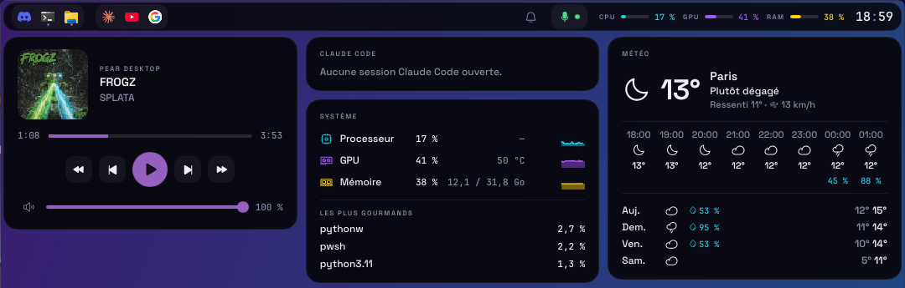
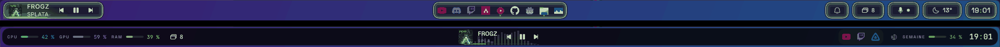
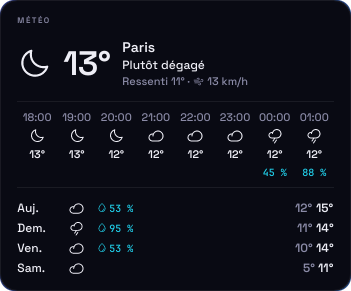

# Horizon

**Une barre d'outils rapide et modulaire en haut de chaque écran, pour Windows 10 et 11.**

Musique, raccourcis, notifications, système, sessions Claude Code, météo, agenda…
dans une appli native qui utilise ~50 Mo de mémoire et se fait oublier.

[**Télécharger**](https://github.com/KingsRequin/horizon/releases/latest) ·
[Fonctions](#fonctions) ·
[Installation](#installation) ·
[Questions](#questions-fréquentes) ·
[English](README.en.md)

## Pourquoi Horizon ?

- **Natif et léger.** Rust + Slint, rendu logiciel, un seul processus : ~50 Mo de mémoire et
  ~1,5 % d'un cœur au repos pour quatre barres. Ni Electron, ni WebView.
- **Une barre par écran.** Elle réserve sa place (les fenêtres agrandies commencent dessous) et
  se cache quand une fenêtre passe en plein écran.
- **À ta façon.** Glisse les widgets, choisis un style par écran, agrandis une barre pour
  afficher des panneaux en tuiles, change de disposition selon l'appli au premier plan.
- **Se met à jour seule.** Les nouvelles versions viennent des Releases GitHub, vérifiées
  (SHA-256) et installées au démarrage suivant.

## Fonctions

**Elle suit la musique.** Pendant la lecture, les îlots s'éclairent avec les basses et flashent à
chaque grosse caisse, aux couleurs de la pochette (le style graphique montre un spectre). Au plus
20 mises à jour par seconde, et seulement quand quelque chose change. Chaque écran a ses propres
animations, dans *Réglages d'Horizon › Barres* ou par clic droit sur la barre : bords, respiration,
onde de kick, ligne d'horizon ou lumière qui tourne pour la barre ; halo, aurore, spectre, ruban,
points ou capsules pour la lecture en cours, dont la barre de progression peut onduler avec le son.

<table>
<tr>
<td width="33%" valign="top"></td>
<td width="33%" valign="top"></td>
<td width="33%" valign="top"></td>
</tr>
<tr>
<td valign="top"><b>Lecture en cours</b> : pochette, commandes, avance à la molette, volume par
appli. La barre s'illumine avec les basses, aux couleurs de la pochette.</td>
<td valign="top"><b>Système</b> : processeur, carte graphique et mémoire en courbes ou en jauges,
et les applis qui en consomment le plus.</td>
<td valign="top"><b>Météo</b> : maintenant, heure par heure et les jours suivants, pour une à trois
villes (Open-Meteo, sans compte).</td>
</tr>
</table>

Survole un widget pour voir son panneau ; agrandis une barre et les panneaux deviennent des
**tuiles** (image du haut), ou range-les dans un **volet** qui descend par-dessus les fenêtres
sans rien retirer à l'écran (pratique sur un écran vertical).

**Deux styles, au choix par écran** : « îlots » (en haut) ou « graphique » (en bas).

**Mode édition** : clic droit sur une barre → *Modifier la barre*. Glisse les widgets d'une zone
ou d'un écran à l'autre, <kbd>+</kbd> pour en ajouter, <kbd>Ctrl</kbd>+<kbd>Z</kbd> pour annuler.

**Palette de commandes** (<kbd>Ctrl</kbd>+<kbd>Alt</kbd>+<kbd>P</kbd>) : recherche floue dans tes
raccourcis, les applis du menu Démarrer, les sorties audio, le minuteur, les profils…

**Widgets**

| | |
|---|---|
| 🎵 **Lecture en cours** | Toute appli reliée aux commandes média de Windows (Spotify, navigateurs, YouTube Music…) |
| 🚀 **Raccourcis** | N'importe quelle icône (logos de marques, images, icônes d'applis), pastille quand l'appli est ouverte |
| 🔔 **Notifications** | Notifications de Windows avec îlot dynamique, Ne pas déranger, appli coupée |
| 📊 **Système** | Processeur, carte graphique, mémoire, en courbes ou en jauges |
| 🎙️ **Micro et audio** | Périphériques par défaut, favoris, volume par appli |
| 🎧 **Batterie du casque** | Plus de 30 casques sans fil lus directement (Logitech, SteelSeries, HyperX, Razer, Corsair, Astro, Audeze, JBL) |
| 🌤️ **Météo**, 📅 **Agenda** | Open-Meteo ; toute adresse iCal (Google, Outlook…) |
| 🪟 **Fenêtres** | Fenêtres ouvertes par écran ; en ramener une sur l'écran courant (clic) ou l'envoyer vers un autre (clic droit) |
| ✨ **Suggestions** | Applis et sites que tu utilises à cette heure-ci |
| 🤖 **Claude Code** | *Module intégré, à activer.* Sessions (travaille, attend, demande d'autorisation), consommation, terminal ramené au premier plan |
| 🖥️ **Serveurs** | *Plugin.* Hôtes de `~/.ssh/config`, état et latence, SSH en un clic |
| 🌀 **[Essaim](https://github.com/KingsRequin/essaim)** | *Plugin.* Pause et choix du preset du curseur animé qui suit la musique |
| 📈 **Quota Claude** | *Plugin.* Quota de l'abonnement Claude : session de 5 h, semaine, limites par modèle |

Une barre neuve ne contient que l'essentiel : lecture en cours, raccourcis, notifications,
système, horloge. Le reste s'ajoute : les autres widgets par le <kbd>+</kbd> du mode édition ;
les modules intégrés (à activer) et les plugins de la
[bibliothèque](https://github.com/KingsRequin/horizon-plugins) (installés d'un clic) dans
*Réglages d'Horizon › Plugins*.

**Et aussi :** minuteur et pomodoro, affichage du volume et du média à la place de celui de
Windows, couleur d'accent tirée du fond d'écran, mode jeu, profils de disposition par appli,
page « État » qui dit ce qui marche et ce qui ne marche pas.

Toutes les fonctions en détail : [docs/guide.md](docs/guide.md).

## Installation

1. Télécharge **`Horizon-Setup-<version>.exe`** depuis la [dernière version](https://github.com/KingsRequin/horizon/releases/latest)
   et lance-le. Horizon est installé dans `%LOCALAPPDATA%\Programs\Horizon`, démarre avec
   Windows et apparaît dans le menu Démarrer. Pas besoin de droits administrateur.
2. *(Facultatif)* Pour afficher les notifications des autres applis, active le **mode
   développeur** de Windows (Paramètres → Système → Espace développeurs), puis relance
   l'installateur.

Ensuite : clic droit sur une barre → **Modifier la barre**.

Désinstaller : Paramètres de Windows → Applications → Applications installées → Horizon
(l'assistant demande s'il faut aussi effacer tes réglages).

Installé avec l'ancien zip (`Installer.cmd`) ? Rien ne change, les mises à jour continuent.
Lancer l'installateur par-dessus garde tes réglages et ajoute Horizon aux applications
installées de Windows.

## Questions fréquentes

<b>Windows affiche « Windows a protégé votre ordinateur ».</b>

Horizon n'est pas signé (un certificat coûte cher pour un projet gratuit). Clique sur
*Informations complémentaires* → *Exécuter quand même*. Le code est ici, et chaque version est
compilée par GitHub Actions à partir de ce dépôt.

<b>Pourquoi le mode développeur pour les notifications ?</b>

Windows ne laisse lire les notifications qu'aux applis qui ont une *identité de paquet*.
Horizon en enregistre une sans signature, ce que Windows n'accepte qu'en mode développeur.
Détails : [docs/notifications.md](docs/notifications.md).

<b>Est-ce que ça modifie ma configuration de Claude Code ?</b>

Si Claude Code est installé, l'installateur propose (case cochée) d'ajouter les hooks d'Horizon
dans `%USERPROFILE%\.claude\settings.json` (une copie de sauvegarde est gardée). Ils ne font que
signaler les événements à Horizon et ne répondent jamais aux demandes d'autorisation.
Décoche la case pour s'en passer ; la désinstallation les retire.

Le suivi des sessions est un module intégré : avec les hooks, il est activé (son widget s'ajoute
par le <kbd>+</kbd> du mode édition) ; sans eux, sur une installation neuve, rien ne tourne. Il
s'active et se désactive dans *Réglages d'Horizon › Plugins*.

<b>Où sont mes réglages ?</b>

Dans `%APPDATA%\Horizon` (`layout.json`, `settings.toml`, journal). La plupart des options sont
dans le menu du clic droit sur une barre → *Réglages d'Horizon*.

## Feuille de route

- **Plugins** (préversion, l'API peut encore changer) : des widgets dans leur propre dossier
  (interface Slint + JavaScript), chargés sans redémarrer. Ils s'installent d'un clic depuis la
  [bibliothèque](https://github.com/KingsRequin/horizon-plugins) (*Réglages d'Horizon ›
  Plugins*) ou s'écrivent avec une IA grâce au [guide](docs/PLUGINS.md).
- **Traductions.**

## Fait avec Claude Code

Horizon a été entièrement écrit avec [Claude Code](https://claude.com/claude-code), l'agent de
programmation d'Anthropic. [KingsRequin](https://github.com/KingsRequin) l'a conçu et a supervisé
tout le travail : chaque fonction a été décidée, relue et testée sur une vraie installation à
quatre écrans avant d'être gardée.

## Contribuer

Bugs et idées : [issues](https://github.com/KingsRequin/horizon/issues). Compiler et organisation
du code : [CONTRIBUTING.md](CONTRIBUTING.md).

## Licence

[MIT](LICENSE). Icônes, polices et protocoles de casques repris : voir
[THIRD-PARTY-NOTICES.md](THIRD-PARTY-NOTICES.md).
